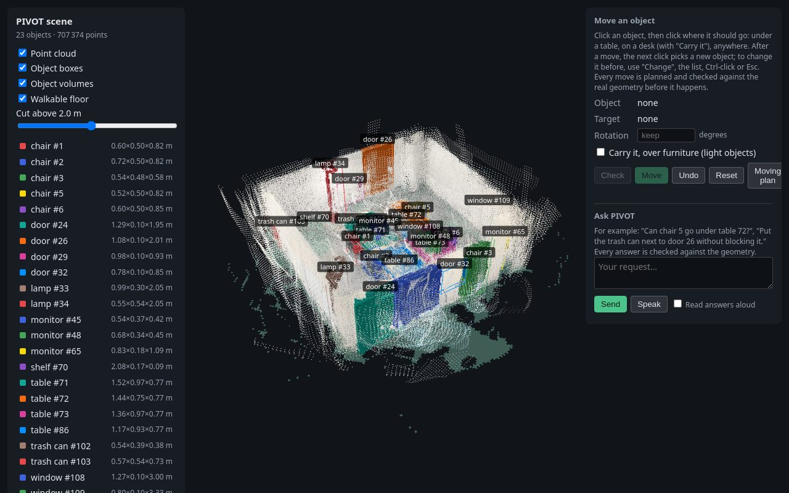
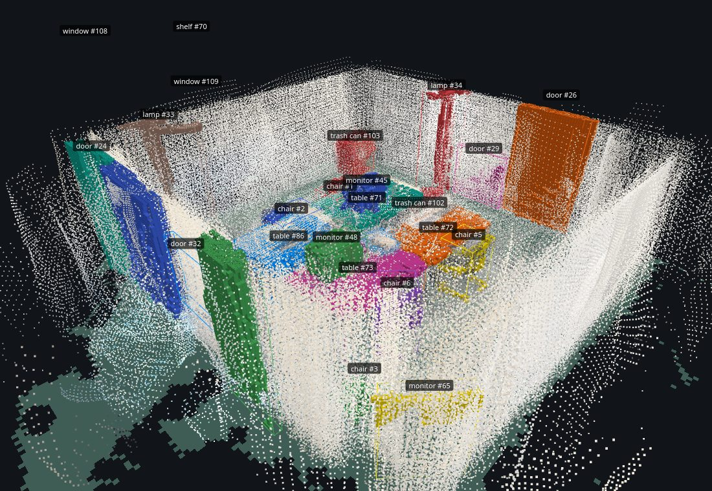
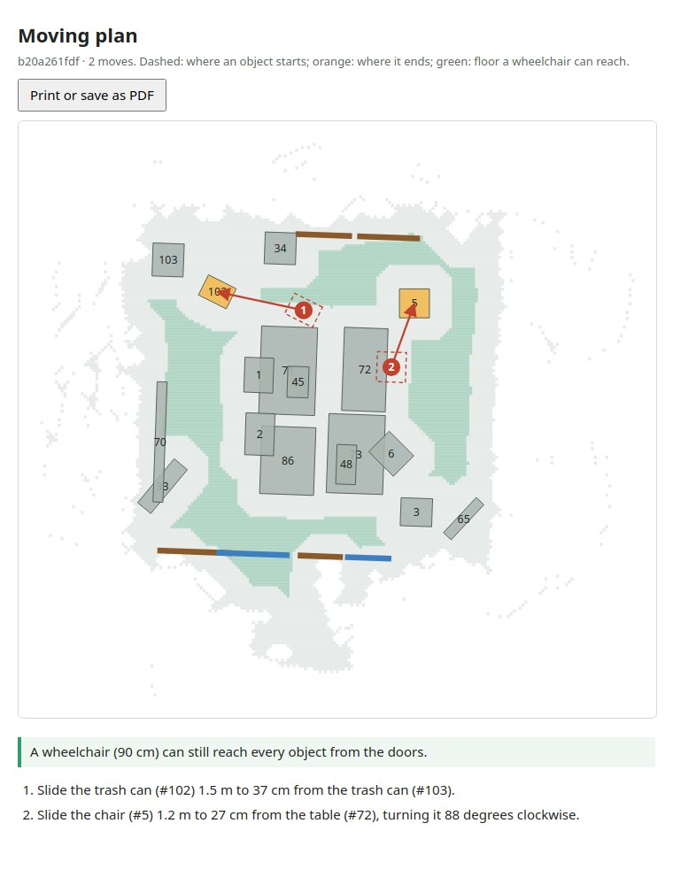
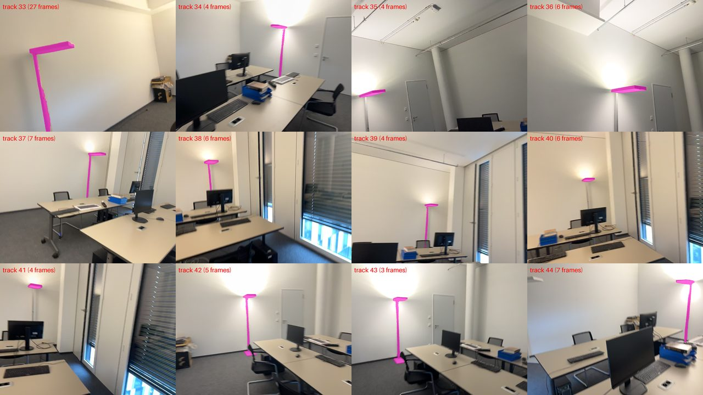
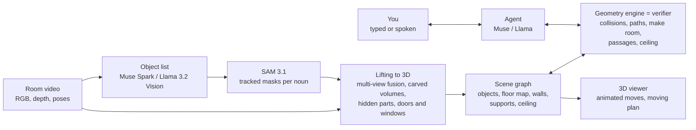

# PIVOT!

*From seeing a room to proving how to change it.*

[](https://marina-beguin--pivot-demo-web.us-east.modal.run)
[](https://github.com/MarinaBeguin/PIVOT/actions/workflows/ci.yml)


**Film a room, then ask in plain words, typed or spoken, whether furniture fits and how to
rearrange it.** PIVOT rebuilds the room in 3D, finds every object with **SAM 3.1**, and a
**Muse** (or **Llama**) agent answers by calling geometric tools that check every claim:
collisions on the real shapes, room to pass, ceiling height, a complete collision-free path.
The language model never makes up geometry: every answer is backed by a computation.

Built for the **Meta Global AI Hackathon 2026** (October 26 to November 4, 2026), Indie
Developer category, problem statement **"Push the Frontier"**. It gives assistants and robots a
new capability, reasoning about real space with answers they can prove.



## For the Judges

| | |
|---|---|
| **Live demo** | **[marina-beguin--pivot-demo-web.us-east.modal.run](https://marina-beguin--pivot-demo-web.us-east.modal.run)**: four scanned rooms, the agent and the voice, in the browser, nothing to install |
| **Video (3 min)** | **[Watch the correct, complete PIVOT! demo](https://youtu.be/XLgffcd7El4)** |
| **Built during the event** | Everything here: the repository was created on October 27, 2026, and its [history](https://github.com/MarinaBeguin/PIVOT/commits/main) shows each step. The rooms are public ScanNet++ captures |
| **Problem statement** | Push the Frontier: [why](#why-this-is-push-the-frontier) |
| **Evaluation** | [eval/](eval): 139 requests on four regenerated scenes, four variants, and archived results |

> **Video link correction:** the original hackathon submission accidentally linked the wrong video.
> Please use the [correct, complete demo](https://youtu.be/XLgffcd7El4) for judging.

**Try it in two minutes.** Open the demo (the first visit after a quiet period takes about 10 s).
Ask *"Can chair 5 go under table 72?"*, then *"Put trash can 102 next to door 26 without
blocking any door"*: the chair and the can move along verified paths, and the answers quote the
measurements. Ask for something impossible (*"Put the shelf on table 72"*): PIVOT refuses, with
the numbers. Pick the classroom and ask to make room for a wheelchair at a table, then open
**Moving plan** for the printable steps. The language menu switches everything, the agent's
answers included, to French, German, Spanish, Italian or Chinese.

**Where to look, by criterion.**

| Criterion | In PIVOT |
|---|---|
| **Impact** | Spatial hallucination is the first thing that fails when an assistant looks at the real world. On 139 requests across four regenerated scenes, PIVOT succeeds on 134, versus 47 for Muse alone; erroneous success claims fall from 91 to 3 ([results](#results)). Checks apply to the reconstructed geometry. For people furnishing a home, wheelchair users and their therapists, wearers of Meta glasses, robots ([who it is for](#who-it-is-for)) |
| **Meta AI tooling** | Meta models along the whole chain: SAM 3.1 to see (videos, photos, and blurring faces and plates), Muse Spark to list the objects and as the agent, Muse Voice Transcribe to listen, Llama with open weights for the same agent without a key, Llama Guard to screen requests, CoTracker3 and MapAnything ([table](#meta-ai-models)) |
| **Demo** | Live and public, on a phone too, in six languages; every visitor gets their own copy of the rooms |
| **Technical depth** | SAM 3.1 masks lifted to carved 3D volumes; A* in (x, y, rotation) with exact re-validation; making room by moving the fewest objects; a judge that replays every motion; SAM 3.1's masks decoded by compiled code, over 100 times faster than the reference parser ([how it works](#how-it-works), [engineering](#engineering)) |

**Agentic.** One request becomes a multi-step plan the agent carries out alone: it lists the
objects, checks candidate spots, plans paths, moves what is in the way and puts it back, checks
that the doors are still clear and that a wheelchair still gets through, then answers, revising
its plan whenever a tool says no. It has 18 tools and may state nothing a tool did not compute.

## Why this is Push the Frontier

Language models can describe a room but cannot be trusted with its geometry; geometric planners
can prove a move but cannot read a request. No assistant today can be asked, in words, "can this
sofa get to the window?" and answer with a proof. PIVOT gives a machine that capability: from a
phone video, it builds a 3D model of the room an agent can act on, and every answer it gives is
a computation on that model: a collision-free path, a measured clearance, a passage wide enough
for a wheelchair. The same verification layer is what assistants on glasses and home robots
need before they talk about the physical world, or act in it.

---

## The problem: AI assistants hallucinate space

Large language models reason well about intentions ("clear the way to the window") but not
about centimeters. Asked about a real room, they state that a sofa "fits" or a chair "can go
under the desk" without being able to check: **spatial hallucination**. A wrong spatial answer
is costly: a sofa that does not pass the door, a returned order, a passage left too narrow for a
wheelchair. It is also the first thing a user notices.

Geometric planners, on the other hand, can verify a move but do not understand a request made in
words. **PIVOT combines both**: the language model interprets the request and decides what to
test; a geometry engine acts as the verifier and returns measurements (penetration depth,
clearance, path length); the model revises its proposal until a verified solution exists, or
explains with the measured numbers why it is impossible and proposes the closest feasible
alternative.

Across **139 requests on four regenerated ScanNet++ scenes**, PIVOT succeeds on
**134/139 (96.4%)**, compared with **47/139 (33.8%)** for Muse alone when explicit errors
count as failures. PIVOT still makes **3 erroneous success claims and 2 false refusals**:
verification reduces errors but does not eliminate them ([results](#results)).

## Who it is for

| User | What they ask | What PIVOT adds |
|---|---|---|
| **People moving or furnishing a home**, furniture buyers (e.g. on Facebook Marketplace) | "Will this sofa fit next to the window, and can it get there through the door?" | A verified path, not just a measurement: the move is checked from the door to its spot. Fewer returns. |
| **Wheelchair users, elderly people living at home, occupational therapists** | "Can a wheelchair still reach every part of the room if I move the desk here?" | A passage check at 90 cm from the doors, and the list of moves that make a room accessible. Measured, not estimated. |
| **Wearers of Meta Ray-Ban / Oakley Meta / Orion glasses** | Looking at the room: "Where can I put this desk and keep 90 cm of passage?" | Spoken question, spoken answer, every number verified: the spatial layer Meta AI needs to answer about the physical world. |
| **Quest (mixed reality) users** | "Free a 2 × 2 m play area." | The fewest moves of chairs and tables that clear the space, each one checked. |
| **Home robotics** (e.g. Meta FAIR's Habitat and PARTNR settings) | A rearrangement plan written by a language model | The verification layer between a plan in words and its physical execution. |

The core of PIVOT is not interior design: it is **verified spatial reasoning**: an assistant that
understands a request in words and answers only with what it computed on the real geometry. That
is what an assistant that sees the world through a camera, as on Meta's glasses and headsets,
is missing today. The whole chain uses Meta models: SAM 3.1 to see, Muse or Llama to reason,
Muse Voice Transcribe or wav2vec 2.0 to listen.

## What it does

Two requests on the scanned office (wording abridged; every number comes from the geometric
tools on this scene):

> **You:** Can chair 5 go under table 72?
> **PIVOT:** Yes. I checked that it can slide under the table without hitting anything, as far in
> as it goes: 44% of the chair ends under the table top. The tightest spot on the way leaves 5 cm.
>
> **You:** Put trash can 102 next to door 26 without blocking any door.
> **PIVOT:** Done. I slid it 2.5 m to the wall right beside door 26, 5 cm from the frame and out
> of the passage; the tightest spot on the way left 6 cm. A closer free spot would have stood in
> front of door 29, so I did not use it. A wheelchair can still reach every object from the doors.

- **Verified moves.** Collisions are tested on carved voxel volumes, not boxes, so a chair can
  slide under a table top; every path is searched in (x, y, rotation) and re-validated exactly.
- **Make room.** When other objects block the way, they are pushed aside, the object passes,
  then they are put back as close as possible to where they were.
- **Room to room.** A home scan is split into rooms at its doorways, each named after what it
  holds (a bed makes a bedroom, an oven a kitchen). "Move the armchair to the bedroom" finds a
  free spot there, against a wall, and a verified path through the doors; PIVOT says which doors
  it passes and how much room is left in the tightest one, or why it cannot (a 90 cm sofa does
  not go through a 90 cm door).
- **Carry** light objects over furniture, or put them on a desk; gravity keeps every object on a
  surface; nothing may rise above the **ceiling**.
- **Accessibility.** After a rearrangement, PIVOT checks that a person (60 cm) or a wheelchair
  (90 cm) can still reach every object from the doors, and names any furniture left in front of
  a door, even partly, saying whether a move put it there.
- **Moving plan.** A printable page with a plan seen from above, each object's path drawn as the
  3D view plays it, and numbered steps ("Slide the chair (#5) 1.2 m to 27 cm from the table
  (#72), turning it 90 degrees"), flagging the moves that need **two people**.
- **Voice.** Speak instead of typing (Muse Voice Transcribe, or wav2vec 2.0 with open weights);
  answers can be read aloud, as on glasses without a screen.
- **Undo** any move, including multi-step ones; the 3D viewer animates every executed path, and
  each object takes its own reconstructed points along, so nothing is left behind. A request
  that takes too long can be **stopped**: the search ends at once, the moves already made stay.
- **Replace furniture.** Take an object out of the room ("remove the old sofa"), then bring a new
  one in **from a photo**: taken with the phone or picked from the gallery, Muse Spark names it and
  estimates its size, which a dialog asks you to check (when the photo shows several objects, you
  pick one first), and SAM 3.1 cuts it out of the photo. You then put it where you want it, turned
  as you like: its outline follows the cursor, green where it fits, red where something stands;
  it never lands hidden under a table, though you can push it there afterwards. A painting or a
  mirror hangs on the wall nearest to where you click, at eye level, clear of the furniture and
  of the doors and windows; moved later, it is taken off and hung on another wall. New furniture is often delivered flat-packed and assembled in place, so no path from the
  door is needed; if the spot is taken, PIVOT moves what stands there aside, each with a verified
  motion, and says which doors it would also pass assembled. From then on it moves like any other
  object, with a verified path.
- **In your language.** The page follows the browser's language (English, French, German,
  Spanish, Italian, Chinese), which a menu can change; objects, rooms, voice and the agent's
  answers follow. A short tour in speech bubbles introduces the page on the first visit.
- **On a phone too.** The room fills the screen; the display options, the moves and the
  questions open as drawers from a bar at the bottom, and step aside while a move plays.

<table>
<tr>
<td width="50%"></td>
<td width="50%"></td>
</tr>
<tr>
<td>The office rebuilt from an iPhone scan: 23 objects as carved volumes, doors and windows set in the walls.</td>
<td>The printable moving plan: numbered moves, and in green the floor a wheelchair can still reach.</td>
</tr>
</table>

## Meta AI models

| Model | Role in PIVOT | API version | Open-weight version |
|---|---|---|---|
| **SAM 3.1** | Segments and tracks every object of the video from a noun ("chair", "lamp") | Meta Model API, read with Meta's SAM parser | Self-hosted weights (multiplex video predictor, 64 objects per prompt) |
| **Muse Spark 1.3** | Agent with 18 tools: geometric checks and moves, taking objects out, bringing new ones in; lists the kinds of objects a video shows (optionally watching the whole video) | Meta Model API | |
| **Muse Spark 1.3** with web search | Finds the published size of a product the user names ("IKEA KIVIK 3-seat sofa"), or of the product of a link (a shop, a Marketplace ad, read as a link preview), and quotes the page | Meta Model API | |
| **Llama 3.1 8B Instruct** | The same agent, with tool calling | | Served by vLLM on the GPU |
| **Muse Glimmer 30B** | Optional: the same agent, distilled from Muse Spark (`PIVOT_OPEN_AGENT=glimmer`) | | Served by vLLM on two 48 GB GPUs |
| **Llama 3.2 11B Vision Instruct** | Lists the kinds of objects a video shows | | Hugging Face transformers, on the GPU |
| **Muse Voice Transcribe 1.0** | Spoken requests, with the scene's object names as keywords | Meta Model API | |
| **Muse Spark 1.3** (vision) and **SAM 3.1** (image) | Name and size an object from a photo, and cut it out | Meta Model API | |
| **Llama Prompt Guard 2** (86M) and **Llama Guard 3** (1B) | Optional screening of the public demo's requests, on the CPU, before any API call | | Hugging Face transformers, on the CPU |
| **SAM 3.1** (video) | Blurs people, faces, plates and writing in a visitor's own video, before anything else sees it | Meta Model API | |
| **MapAnything** | Cameras and metric depth from a plain phone video, without a depth sensor | | Apache 2.0 weights, on the GPU |
| **CoTracker3** | Optional: follows an object's pixels across the cut between two pieces of video tracked in parallel, to join its tracks | | PyTorch, on the GPU or the CPU |
| **wav2vec 2.0** (large, 960 h) | Spoken requests (English) | | Hugging Face transformers, on the CPU |
| **MMS-TTS** | Default on the Modal demo; optional for local hosting: answers read aloud in one voice on every device, in English, French, German and Spanish (`PIVOT_TTS=mms`; non-commercial licence) | Server's CPU | Server's CPU |
| **SceneScript** | Optional: doors and windows read from the point cloud, to compare with PIVOT's own (non-commercial licence) | | Its own environment, on a CUDA GPU |

Two of these come under a non-commercial licence: **MMS-TTS** (CC-BY-NC 4.0) and **SceneScript**
(CC BY-NC). They suit a demo and research, not a paid service; their weights are downloaded from
their publishers on first use and never stored in this repository, whose MIT licence covers
PIVOT's own code only. Without them, the page reads answers with the browser's voice and PIVOT
places doors and windows itself.



## How it works



1. **Perception.** A vision model looks at frames spread over the video and names the kinds of
   objects that matter (up to 20 through the API, 8 with open weights); SAM 3.1 tracks each one
   through the video. Through the API, the video is uploaded once and every kind of object is
   tracked at the same time. Two faster options exist, off by default because they change the
   scene: skipping the frames where the camera barely moved (small objects change), and cutting a
   long video into overlapping pieces tracked in parallel, their tracks joined on the shared
   frames and across the cut by Meta's CoTracker3 following the object's pixels (an object out of
   view at a cut still splits in two). Results are cached per video, so a scene is segmented once.
2. **From 2D to 3D.** Each mask is back-projected with depth; a point is kept only if several
   views agree (voxel voting). Tracks are merged or split with explicit rules (never merge two
   tracks SAM separated in the same frame; a part whose mask lies inside another object's mask is
   attached to it). Objects become 4 cm voxel shapes carved by the free space seen through them,
   thin legs kept from the masks; hidden parts are completed at the visible heights, and a rug
   goes on as a rectangle under the furniture that hides it (taking the bed out shows the whole
   rug, and a rug too wide for a doorway is moved rolled up); doors and windows are snapped into
   the walls, and a window closes its wall (the floor seen through the glass is not a way out).
3. **The verifier.** Placement checks (collisions, walls, clearance, ceiling, warnings in front of
   doors and windows), A* motion planning in (x, y, yaw) by height slabs with exact re-validation,
   blocking objects moved aside and put back, carried moves (lift, carry, lower), passage checks.
   Poses proven free are not checked one by one and checked segments are remembered, and A* is
   guided around the walls: a battery of 33 moves takes 110 s instead of 235 s, with the same
   verdicts, and planning a chair's way from the living room to the bedroom 7 s instead of 21 s.
4. **The agent.** Muse or Llama gets the request and 18 tools. Its instructions forbid any claim
   no tool result supports, and require it to quote the measurements, in plain language.

## Results

### Regenerated-scene evaluation

The run `eval_20261104_155715` contains **139 requests on four regenerated ScanNet++
scenes**, each evaluated with four variants: **556 task/variant records**, with no missing
or duplicate pairs. There are **46 feasible and 93 infeasible requests** under the
benchmark's geometric search and task criteria. Tasks include placement, moving between
rooms, turning, clearing doors, wall placement and wheelchair access; available kinds
vary by scene. [Archived records, task lists and audit](eval/results/2026-11-04-regenerated)
were documented on **November 5, 2026**; the original records are preserved.

| Variant | Success (95% Wilson CI) | Feasible tasks | Infeasible tasks | Erroneous success claims | False refusals |
|---|---|---|---|---|---|
| Muse alone | 47/139 — 33.8% (26.5–42.0%) | 25/46 | 22/93 | 91/139 | 0/139 |
| Muse + a final feasibility check | 115/139 — 82.7% (75.6–88.1%) | 34/46 | 81/93 | 19/139 | 5/139 |
| **PIVOT: Muse + verifying tools** | **134/139 — 96.4% (91.9–98.5%)** | **41/46** | **93/93** | **3/139** | **2/139** |
| Geometric search alone | 139/139 — 100% (97.3–100%) | 46/46 | 93/93 | 0/139 | 0/139 |

An **erroneous success claim** means the system returned a placement or movement that
failed the judge's route or task checks, including a wrong final position; it does not
necessarily mean a collision. A **false refusal** means no placement was returned for a
request labelled feasible. All geometric checks concern the reconstruction, not physical
measurements of the real room.

**One reporting correction:** the original classroom summary counts a Muse-alone API
timeout (`t021`, `wheelchair_way`) as a correct refusal because that task is labelled
infeasible. The table above counts that explicit error as a failure: **47/139**, rather
than the original **48/139**. No rows are dropped, and PIVOT's score is unaffected. The
original JSONL and summaries remain unchanged alongside the separate [audit](eval/results/2026-11-04-regenerated/audit.json).

| Scene | Requests | Muse alone | Muse + final check | PIVOT | PIVOT erroneous success claims | PIVOT latency p50 |
|---|---|---|---|---|---|---|
| Office | 39 | 18/39 | 30/39 | **38/39** | 1 | 27.0 s |
| Bedroom | 25 | 7/25 | 18/25 | **25/25** | 0 | 26.6 s |
| Classroom | 40 | 12/40* | 36/40 | **39/40** | 0 | 46.6 s |
| Apartment | 35 | 10/35 | 31/35 | **32/35** | 2 | 27.5 s |

\*Counts the timeout as a failed request. Latencies come from the recorded benchmark,
not the hosted demo; hardware, API load and deployment configuration can change them.
The geometric-only variant scores 100% in every scene.

**Remaining PIVOT failures:** three wall-placement requests returned positions that did
not satisfy the benchmark's wall criterion (one office, two apartment); one classroom
wall-placement request and one apartment tuck-under request were refused despite their
feasible labels. The bedroom/classroom/apartment subset totals **96/100**, with two
erroneous success claims and two false refusals.

**Protocol limits.** The office was already used for development, and reconstruction was
tuned on the other rooms too. This rerun is therefore not evidence of generalization to
unseen rooms. Scene fingerprints were verified against the archived scene snapshots;
the artifacts do not record a launch code commit or exact model version, so a frozen-code
held-out protocol cannot be established. Geometric search receives structured tasks,
and the labels come from that same planner: its 100% checks internal consistency, not
independent physical ground truth. Wilson intervals summarize requests in these four
rooms; they do not establish performance across arbitrary buildings. These results cover
the API variants, not an end-to-end open-weight evaluation.

### Separate safety contracts

The recorded CPU-only safety run reports **41 passed, 1 expected failure**, with no
unexpected failures. It covers route/doorway checks, scripted alternative → confirmation
→ undo dialogue, rollback and search-budget reporting. The expected failure tracks undo
of a route confirmed without any furniture movement. These synthetic/scripted contracts
are separate from the live-model benchmark and do not establish real-world accessibility
or browser correctness. [Recorded safety report](eval/results/2026-11-04-regenerated/safety/safety.log).

### Earlier development result

The previous **36-request office development set** produced 36/36 successes for PIVOT
and 19/36 for Muse alone after three PIVOT errors had been studied and fixed. Those tasks
guided development, so the old 100% is optimistic and is not the latest four-scene result.
See [evaluation protocol and reproduction commands](eval/README.md).

## Two versions: with or without an API key

| | **API version** | **Open-weight version** |
|---|---|---|
| Needs | A Meta Model API key | An NVIDIA GPU (SAM 3.1 peaked at 45 GB on an A6000), no key |
| Object list | Muse Spark (up to 20 kinds) | Llama 3.2 Vision (up to 8 kinds) |
| Segmentation | SAM 3.1 through the API, every kind of object at once | SAM 3.1 self-hosted, 3 GPU jobs in parallel |
| Agent | Muse Spark | Llama 3.1 8B, or Muse Glimmer 30B (vLLM) |
| Voice | Muse Voice Transcribe | wav2vec 2.0 (English) |

The open-weight script sends nothing to the Meta API, even with a key in .env: SAM 3.1 API
results already computed for the video are reused as they are, else everything runs on your
GPUs. The Meta API key is never sent to the local model server either.

### Input

A capture with color frames, depth and camera poses: a **ScanNet++ iPhone capture** (RGB,
LiDAR depth, ARKit poses) and its video (one frame out of 10), or **any phone video**, from
which Meta's MapAnything computes the cameras and the depth (see
[your own video](#your-own-video)).

### API version

```bash
git clone https://github.com/MarinaBeguin/PIVOT.git && cd PIVOT
pip install -e ".[serve,fast]"  # fast: numba, which decodes SAM 3.1's masks 100 times faster
cp .env.example .env            # then set META_API_KEY in .env (never committed)

bash scripts/run_api.sh <scannetpp_scene_dir> <video.mp4> <out_dir>
# open http://127.0.0.1:8765 (from another machine: ssh -L 8765:127.0.0.1:8765 <host>)
```

The script lists the objects, tracks them with a progress bar and a time estimate, builds the 3D
scene, then serves the viewer with the agent. Every step already done is skipped on the next run.

### Open-weight version (no key)

```bash
bash scripts/gpu/setup_sam3_env.sh     # once: SAM 3.1 environment and weights
bash scripts/gpu/setup_llama_env.sh    # once: vLLM, Llama 3.1 8B and Llama 3.2 Vision
bash scripts/run_open.sh <scannetpp_scene_dir> <video.mp4> <out_dir>
```

The SAM 3.1 and Llama weights are gated on Hugging Face: first request access to
[SAM 3.1](https://huggingface.co/facebook/sam3.1),
[Llama 3.1 8B Instruct](https://huggingface.co/meta-llama/Llama-3.1-8B-Instruct) and
[Llama 3.2 11B Vision Instruct](https://huggingface.co/meta-llama/Llama-3.2-11B-Vision-Instruct).

### Options of both scripts

```bash
bash scripts/run_api.sh --quality fast <scene> <video> <out>   # fast (1/3 of the frames), medium (1/2), full
bash scripts/run_api.sh <scene> <video> <out> sofa bed "coffee table"   # your own object list
```

| Variable | Default | Meaning |
|---|---|---|
| `PIVOT_SAM_WORKERS` | 32 (API), 3 (GPU) | Requests (API) or GPU jobs at the same time |
| `PIVOT_KEYFRAMES` | 0 | 1: through the API, track only the frames where the camera moved by 8 cm or turned by 5° (half the frames of the apartment, but small objects change: off by default) |
| `PIVOT_CHUNK_FRAMES` | 0 | N: through the API, track the video in pieces of N frames, joined afterwards. SAM 3.1 follows at most 16 objects of one kind per request: crowded rooms (a classroom's chairs) need pieces, e.g. 200 |
| `PIVOT_PARSE_WORKERS` | cores, up to 16 | Processes reading SAM 3.1's responses. Meta's parser decodes each mask in pure Python, and twice (once to check it); with numba installed (`.[fast]`), PIVOT decodes them with compiled code, once, giving the same pixels: a 1.7 MB response is read in 1.2 s instead of 170 s |
| `PIVOT_SAM_WIDTH` | 0 | W: SAM 3.1 tracks the video scaled to W pixels wide (480: a quarter of the pixels of 960). 0 keeps the video's size |
| `PIVOT_MAX_OBJECTS_API` / `PIVOT_MAX_OBJECTS_OPEN` | 20 / 8 | Most kinds of objects listed |
| `PIVOT_AGENT_MODEL` | `muse-spark-1.3` | Agent model, e.g. `muse-wonder-1.0` for the stronger preview model |
| `PIVOT_OPEN_AGENT` | `llama` | Open-weight agent: `llama` (Llama 3.1 8B) or `glimmer` (Muse Glimmer 30B, two GPUs) |
| `PIVOT_OPEN_URL` / `PIVOT_OPEN_API_KEY` | local vLLM / none | Server of the open-weight agent, e.g. a provider hosting Muse Spark Open, and its own key |
| `PIVOT_INVENTORY_VIDEO` | 0 | 1: Muse Spark watches the whole video to list the objects, instead of a sheet of frames |
| `PIVOT_TTS` | unset | `mms`: answers read aloud by MMS-TTS (`pip install -e ".[guard]"` for torch and transformers) |
| `PIVOT_GUARD` | unset | Screen requests in words: `prompt-guard`, `llama-guard` or both (`pip install -e ".[guard]"`; gated weights: `HF_TOKEN`) |
| `PORT` | 8765 | Port of the viewer |
| `PIVOT_SCRATCH` | `~/pivot_scratch` | Large storage: environments, weights, caches, logs |
| `PIVOT_SLURM_PARTITION` | Slurm's default | Partition of the GPU jobs (open-weight version) |

Settings of your machine can go in `scripts/site.env` (never committed), which the scripts read
first, e.g. `PIVOT_SCRATCH=/data/me` and `SLURM_CONF=...`.

### Your own video

Any video filmed with a phone, walking slowly around the room, becomes a room PIVOT can reason
about. No depth sensor is needed: Meta's [MapAnything](https://github.com/facebookresearch/map-anything)
(Apache 2.0 weights) computes the camera of every frame and a metric depth map from the images
alone, on a GPU, and writes them in the layout of a ScanNet++ capture; the rest of the pipeline
is the same.

```bash
bash scripts/gpu/setup_mapanything_env.sh          # once: MapAnything environment and weights
bash scripts/run_video.sh my_room.mp4 <out_dir>     # cameras and depth, privacy, objects, scene
```

**Privacy.** A video filmed at home or in a staircase shows more than furniture: faces, names
on letter boxes and door bells, parcel labels, a car's plate through a window. Before anything
else sees the frames, SAM 3.1 tracks people, faces, plates and writing through the video, and
every pixel it finds is blurred, with a margin; the cloud, the viewer and the moving plan never
show them (`PIVOT_PRIVACY=0` turns it off). Meta's [EgoBlur](https://github.com/facebookresearch/EgoBlur)
would blur faces and plates without the API.

The **Upload your video** tab lets visitors send a personal phone video to the Modal demo.
MapAnything estimates cameras and depth on a GPU, followed by Meta API processing and
PIVOT scene construction. The uploading browser can follow progress, open its private room
and delete the uploaded data. Upload quotas, retention and processing notices are shown in
the tab; see the [deployment guide](deploy/VIDEO_UPLOADS.md) for details.
For local hosting, enable `PIVOT_UPLOADS=1` and configure the GPU pipeline; on a public local
server, this backend is restricted to the owner's browser (`PIVOT_OWNER_KEY`).

### The public demo

Open the [live demo](https://marina-beguin--pivot-demo-web.us-east.modal.run) directly in a browser:
no terminal, installation or personal API key is needed. The room menu offers four
ScanNet++ scenes: **Office**, **Bedroom**, **Classroom** and **Apartment**.
Click an object then a
spot to move it, or ask PIVOT in words or by voice (button "Speak"; answers can be read aloud);
"Remove" takes an object out, "Add from a photo" brings a new one in, and "Moving plan" opens the printable steps. A menu sets the language, and a
short tour introduces the page on the first visit. Modal deployments use Meta MMS-TTS by
default for reading answers in English, French, German and Spanish; select “Read answers aloud”
to listen. Set `PIVOT_TTS=browser` at deployment time to use device voices instead.
Each visitor works on their own copy of the
room, kept across reloads.

Requests cost real API calls, so the demo has a budget: per visitor and per day, 20 requests and
$1 (a photo counts $0.05, a request what its tokens cost), and $25 in
all; the page shows how many requests are left. The first visit after a quiet period takes
about 10 seconds, while the server starts.

| Variable | Default | Meaning |
|---|---|---|
| `PIVOT_VISITOR_DAILY_REQUESTS` | 20 | Most requests per visitor per day |
| `PIVOT_VISITOR_DAILY_USD` | 1.0 | Most a visitor may spend per day, in dollars |
| `PIVOT_BUDGET_USD` | 25.0 | Most the deployment may ever spend, in dollars |

Deploy your own (needs a Modal account; the key is read from .env). One or several rooms, each
with the name shown in the room menu:

```bash
PIVOT_DEMO_SCENES="Office=<out_dir>/scene;Bedroom=<other_out_dir>/scene" modal deploy deploy/modal_app.py
```

### Docker installation (server and local GPU tools)

The Docker setup covers the server, geometry and evaluation, Meta API tools
(photo, segmentation, agent and speech), plus a GPU image for MapAnything,
local SAM, vision inventory, speech and guards. Separate images prepare vLLM,
SceneScript and optional speech/privacy tools without mixing their CUDA stacks.
See [installation, secrets, model weights and complete commands](docker/README.md).
The local phone-video runner does not require Slurm or Conda on the host.

To serve an existing scene without a GPU:

```bash
docker build -t pivot .
docker run --rm -p 127.0.0.1:8000:8000 --env-file .env \
  -v /absolute/path/to/scene:/scene:ro pivot
```

For the local GPU tools, install the NVIDIA Container Toolkit on the host, then:

```bash
cp .env.example .env  # edit META_API_KEY locally; never commit this file
mkdir -p data weights
docker compose --profile tools build tools
docker compose --profile tools run --rm tools bash docker/tools.sh check
```

Weights and GPU memory requirements vary by model. Optional adapters still in
other branches are identified in the installation guide; installing their
packages does not make those features part of this checkout.

### Command line

```bash
python -m pivot.server --scene-dir <out_dir>/scene --chat          # viewer + agent
python -m pivot.agent --scene <out_dir>/scene/scene.json "Can chair 5 go under table 72?"
python -m pivot.eval generate --scene <scene.json> --tasks tasks.json
python -m pivot.eval run --scene <scene.json> --tasks tasks.json --out results.jsonl
python -m pivot.eval summary --help
```

## What it costs

Every figure below is computed from what PIVOT measured (frames of the real videos, tokens of the
36 evaluation requests, tracking times) and from public prices: the [Meta Model API's list prices](https://dev.meta.ai/docs/pricing-rate-limits)
of November 1, 2026 and [Modal's per-second rates](https://modal.com/pricing). They are list prices: a deployment by Meta itself would
pay its own compute cost instead.

**Building a room, once.** SAM 3.1 is billed $0.0002 per frame and per kind of object tracked;
this is most of the bill. Through the API, every kind of object is tracked at once. The scene is
then cached and never segmented again. Tracking times through the API are estimated from the
measured rate (0.34 s per frame), not yet measured with every kind of object at once. With
`PIVOT_KEYFRAMES=1`, the apartment would cost half (1,367 of its 2,686 frames are kept).

| Room (frames of the video) | API, 20 kinds | API, `--quality fast` | Open weights, 8 kinds, rented 48 GB GPU |
|---|---|---|---|
| Office (704) | $2.80, about 4 min | about $0.90, 1.5 min | 0.8 GPU-hour, about $1.50 to $2 |
| Bedroom (771) | $3.10, about 4.5 min | $1, 1.5 min | 0.8 GPU-hour, about $1.60 to $2 |
| Classroom (1,932) | $7.70, about 11 min | $2.60, 4 min | 2 GPU-hours, about $4 to $5 |
| Whole apartment (2,686) | $10.70, about 15 min | $3.60, 5 min | 2.8 GPU-hours, about $5.50 to $7 |

Listing the objects with Muse Spark adds about one cent. Building the 3D scene runs on the CPU,
with no API cost. On a GPU you already own, the open-weight version costs nothing per room.

**Using it.**

| Action | Cost | Where it comes from |
|---|---|---|
| A question to PIVOT (Muse Spark) | $0.07 on average, $0.04 median, $0.33 at most | Measured: 7 model calls and 49,000 input tokens per request on average, because every tool result is read back |
| The same with Muse Wonder | $0.24 on average | Same tokens at Muse Wonder's prices |
| The same with Llama 3.1 8B | No API cost; $1.95 per hour the GPU is up | vLLM on a rented 48 GB GPU, whether it answers or waits |
| Looking a product's size up on the web | about $0.01 (estimated) | One search ($2.50 per 1,000) and the tokens of the answer |
| A spoken request | $0.0005 for 10 seconds | Muse Voice Transcribe, $0.18 per hour of audio |
| Bringing in furniture from a photo | about $0.01 to $0.02 (estimated), budgeted $0.05 | One Muse Spark call on the image, one SAM 3.1 image segmentation ($0.0025) per noun tried, up to four |
| Screening a request (Llama Guard) | No API cost | On the server's CPU |

These cost figures refer to the earlier 36-request office experiment, not the regenerated-scene run above.
In that earlier experiment, Muse alone answers for $0.02 a question and is wrong in 15 of 36 cases: PIVOT
spends about 3 times more tokens to be right.

**Scenarios.**

| Scenario | Total |
|---|---|
| One room, 20 questions (API) | about $4.20, or $2.30 at fast quality |
| One room, 20 questions, 3 pieces of furniture from photos | about $4.30 |
| Whole apartment, 40 questions, 5 photos | about $13.60, or $6.40 at fast quality |
| One room with open weights, a rented GPU for 1 h of questions | about $3.50; nothing on your own GPU (no photos: they need the API) |

**Hosting.** The public demo runs on one Modal CPU with 2 GB, about $0.06 per hour while awake;
it sleeps after 15 minutes without visitors and costs nothing while asleep. With Llama Guard on,
the container needs more memory (about 6 GB, estimated), about $0.10 per hour.

**What would bring it down at scale.** Most of a question's cost is the same context read again
at each tool call: billed as cached input ($0.15 instead of $1.25 per million tokens), the
average question would cost at most $0.02 instead of $0.07 (PIVOT's ledger counts cached tokens
at the full price, to stay on the safe side). Tracking a third of the frames divides the
building cost by 3, with the risk of missing objects seen only briefly. A room is segmented once,
however many questions follow.

## Engineering

- **Over 300 tests** (geometry, lifting on synthetic rooms rendered exactly, planning, agent with
  a scripted model, server, evaluation, the mask decoder against Meta's), **mypy strict**,
  **pylint 10/10**, Google-style docstrings, all run by one script (scripts/check.sh).
- **CI** on every pull request: install in a fresh environment, tests, mypy, pylint, and the
  Docker image is built. The main branch is protected: changes land only through pull requests with green
  checks.
- **Docker** image for the web app: non-root user, healthcheck, port from the host.
- No secrets in the repository: the API key lives in a git-ignored .env file or in the environment.

```text
src/pivot/
├── geometry/     boxes, voxel shapes, collisions, floor map
├── data/         capture loader (ScanNet++ layout), video encoding
├── reconstruction/ cameras and depth from a plain phone video (MapAnything)
├── perception/   object inventory, SAM 3.1 (self-hosted), detections and tracks
├── meta/         Meta Model API client, SAM 3.1 through the API and its compiled mask decoder,
│                 objects from a photo
├── lifting/      masks to 3D: fusion, carved volumes, hidden parts, doors and windows
├── scene/        scene graph, supports, rooms and doorways, example scenes
├── planning/     placement, motion planning, make room, carry, passages, moving plan
├── agent/        tool-calling agent (Muse or Llama) and its 18 tools (check, move, remove, add...)
├── server/       FastAPI server: viewer, chat, speech, visitors' rooms, budget, request screening
├── viz/          3D viewer (three.js) in six languages, printable plan
├── eval/         task suite, variants, judge, metrics (sets and results in eval/)
└── privacy.py    blurring people, faces, plates and writing in a video (SAM 3.1)
```

## Limitations and roadmap

Known limitations:

- Objects slide and rotate about the vertical axis; they are never tilted, so a sofa that would
  pass a door on its side is reported as too wide. The person carrying an object is not modeled,
  and masses are unknown (the two-person and "can be carried" flags come from size and kind).
- SAM 3.1 tracks the kinds of objects it is given: an object never named is not detected.
- 4 cm voxels: thin tubes can be missed; space never seen (behind a monitor) stays occupied.
  Hidden parts are inferred, not observed.
- The planner treats an object turned half a turn as taking the same room, which is exact for a
  box and approximate for a scanned shape that is not symmetric (a chair with its backrest).
- "No path" means no path exists at the planning resolution (5 cm, 22.5°), not a proof of
  impossibility; making room can still take tens of seconds in hard cases.
- An object brought in from a photo has the size Muse Spark estimates from that photo alone: it
  is approximate, which is why the dialog asks to check it. Its volume is a box, not its shape;
  the cut-out can miss parts hidden in the photo (a throw over a sofa), and transparent objects
  (a glass table) are hard to cut out and to size: both are to improve. Whether it passes a door assembled is
  told from the doors' widths, not from a planned path. Something standing on it in the photo
  (a vase on a sideboard) is cut away by SAM 3.1, and the notch it leaves is filled by a geometric
  rule, which can leave a trace of it.
- Languages: the page, the objects, the agent's answers and the printable moving plan follow
  the six languages, but wav2vec 2.0 (the open-weight voice) understands English only, and the
  evaluation was run in English.
- A room from a plain video has the scale MapAnything estimates, without a depth sensor to
  check it: measurements are less exact than on a LiDAR capture.
- Request screening (Llama Prompt Guard 2, Llama Guard 3) is tested with stand-in classifiers;
  it has not yet been run with the real weights on the public demo.

Next:

- **Videos sent from the public demo**, built on a GPU of the hosting service instead of a
  cluster job.

## Possible extensions, and the Meta models for them

PIVOT's core, a language model that may only state what a geometric verifier computed, does not
depend on the room being indoors or on who asks. Each extension below names the Meta models that
could take on the new part; the verifier stays the same.

| Extension | What it would add | Meta models that could help |
|---|---|---|
| **A realistic view of the plan** | Before moving anything, a photograph of the room as planned. A first version sent the 3D view to Muse Image; it was taken out of the demo because the pictures did not match the room (a view from above came back as another room, furniture was added or dropped). A faithful view needs more than the points: real frames of the scan as references, the list of objects, a fixed viewpoint, and a check of the picture against the scene (count the objects, draw again if they differ) | [Muse Image](https://dev.meta.ai/docs/guides/image-generation) ($0.01 per image), which can also isolate the object of a photo, without what stands on it, before SAM 3.1 cuts it out |
| **Real-looking furniture** | Each object shown as a textured 3D model instead of points; a new piece of furniture tried in 3D from a single photo, with its real shape for the collision checks | [SAM 3D Objects](https://github.com/facebookresearch/sam-3d-objects) (open weights: one image to a 3D object); [Meta 3D AssetGen 2.0](https://developers.meta.com/horizon/blog/worlds/AssetGen2/) (text or image to a textured mesh) for furniture that exists only as a description |
| **Outdoors, with Meta glasses** | "Can I get through here with the stroller?", "Is this path wide enough for my wheelchair?": the same passage checks on a street, a station, a park, from what the wearer sees | [VGGT](https://github.com/facebookresearch/vggt) or [MapAnything](https://github.com/facebookresearch/map-anything) (metric 3D from plain video), SAM 3.1 (curbs, poles, benches), [DINOv3](https://ai.meta.com/dinov3/) (features that hold outdoors); [Project Aria](https://www.projectaria.com/) glasses and their datasets to develop and test |
| **Robots** | A delivery or home robot asks PIVOT before it moves: the plan in words is checked against the real geometry, and the robot gets a verified path | [Habitat 3](https://aihabitat.org/habitat3/) and [PARTNR](https://github.com/facebookresearch/partnr-planner) (simulation and benchmark of rearrangement in homes), [V-JEPA 2](https://ai.meta.com/vjepa/) (world model to plan the robot's actions), [Locate 3D](https://github.com/facebookresearch/locate-3d) (finds the object a sentence refers to in a 3D scan) |
| **People carrying** | The people holding the sofa modeled, not only the sofa: room for their bodies in a stairwell or a doorway | [SAM 3D Body](https://github.com/facebookresearch/sam-3d-body) (the 3D shape and pose of a person from an image) |
| **Loading a van** | "Does everything fit in a 12 m³ van, and in which order?": the same collision checks, applied to packing | No new model: the same geometry engine and agent, plus a search for the packing order |
| **Mixed reality on Quest** | The plan shown in the room itself, each move animated in place, the room taken from the headset instead of a phone scan | The room mesh and anchors Quest already computes ([Mixed Reality Utility Kit](https://developers.meta.com/horizon/documentation/unity/unity-mr-utility-kit-overview/)); Muse or Llama for the agent |
| **The agent at home, on open weights** | The same agent as the API version, on one's own servers: a home scan never leaves the house | [Muse Spark Open](https://dev.meta.ai/docs/muse-spark-open) (816B parameters, 42B active: 300 GB or more even quantized); PIVOT already talks to any OpenAI-compatible server hosting it (`PIVOT_OPEN_URL`), untested |
| **Point at what was missed** | An object never named is not detected: clicked in the 3D view, it is found in the video frames that see that spot and tracked from there | SAM 3.1 with point or box prompts instead of a noun (the API accepts both) |
| **Every language, spoken** | Speech in languages wav2vec 2.0 does not cover, with open weights | [Omnilingual ASR](https://github.com/facebookresearch/omnilingual-asr) (more than 1,600 languages, open weights) |

**Autonomous driving is out of reach of this approach as it is.** PIVOT verifies a static scene
in seconds; a car needs moving obstacles, decisions in milliseconds and safety certification,
none of which PIVOT models. What carries over is the principle, an answer about space backed by a
computation, and static questions such as "does this van fit in this garage?".

## Acknowledgements

- **Meta**, for the models PIVOT is built on (SAM 3.1, Muse Spark, Muse Voice Transcribe,
  Llama, Llama Prompt Guard and Llama Guard, Muse Glimmer, CoTracker3, MapAnything, MMS-TTS,
  SceneScript, wav2vec 2.0), the access to the Meta
  Model API, and the Global AI Hackathon.
- **Modal**, which hosts the live demo.
- **Cyber Valley**, for its support.
- **ScanNet++**, whose iPhone captures are the rooms PIVOT rebuilds; the data is used under the
  [ScanNet++ Terms of Use](https://kaldir.vc.in.tum.de/scannetpp/).
- The open-source projects PIVOT runs on: PyTorch, Hugging Face Transformers, vLLM, NumPy,
  SciPy, FastAPI and three.js.

## Citation

If you use PIVOT or build on it, please cite it (GitHub's "Cite this repository" button gives
the same entry, from [CITATION.cff](CITATION.cff)):

```bibtex
@software{beguin2026pivot,
  title  = {{PIVOT}: From seeing a room to proving how to change it},
  author = {Beguin, Marina},
  year   = {2026},
  month  = nov,
  url    = {https://github.com/MarinaBeguin/PIVOT},
  note   = {Verified spatial reasoning with Meta models, built for the Meta Global AI Hackathon 2026}
}
```

The rooms come from the ScanNet++ dataset. If you use PIVOT with ScanNet++ data, please cite it
as its authors ask:

```bibtex
@inproceedings{yeshwanthliu2023scannetpp,
  title     = {ScanNet++: A High-Fidelity Dataset of 3D Indoor Scenes},
  author    = {Yeshwanth, Chandan and Liu, Yueh-Cheng and Nie{\ss}ner, Matthias and Dai, Angela},
  booktitle = {Proceedings of the International Conference on Computer Vision ({ICCV})},
  year      = {2023}
}
```

## AI Assistance Disclosure

Claude Code (Anthropic) was used as a development assistant throughout this project, primarily for code review, refactoring, debugging, and improving software engineering practices. It also assisted with development tooling (including Docker configuration and documentation) and drafting Git commit and pull request messages.

The research methodology, algorithmic design, experimental setup, and interpretation of results remain the responsibility of the author. AI-assisted changes were reviewed and validated before integration.

## License

MIT, see [LICENSE](LICENSE).
