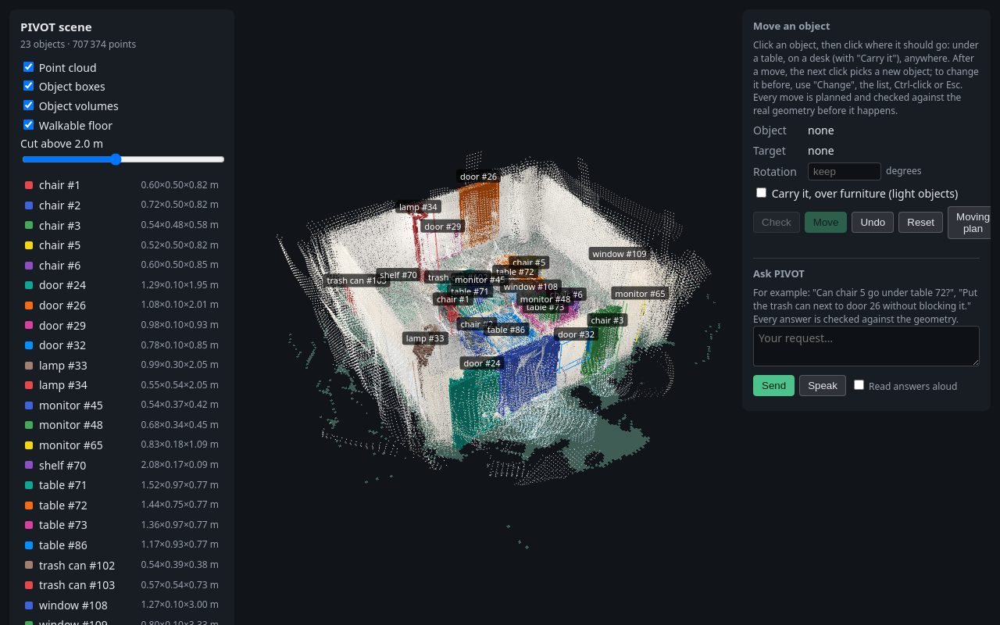
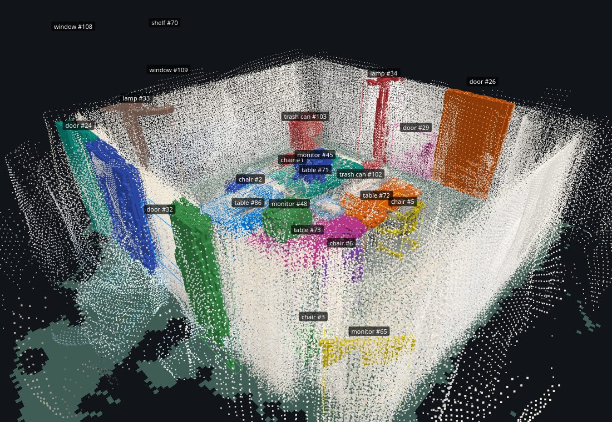
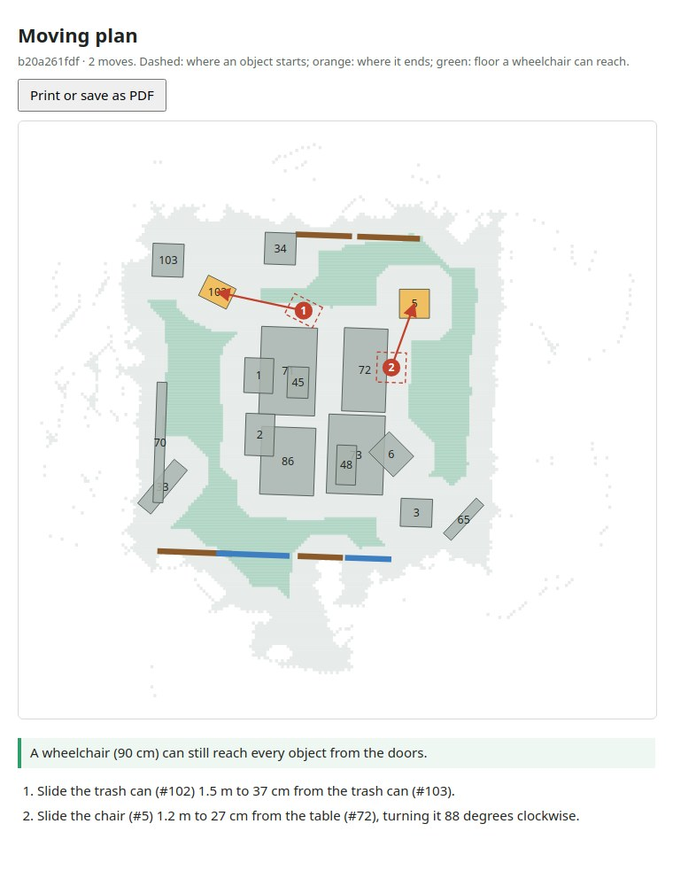
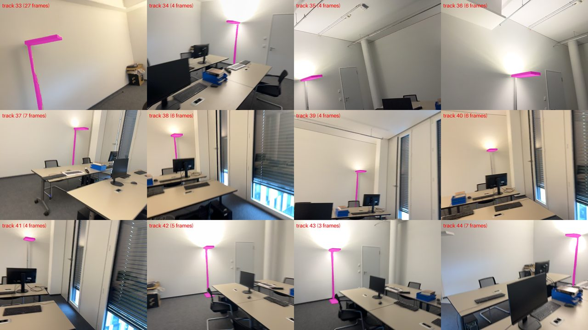
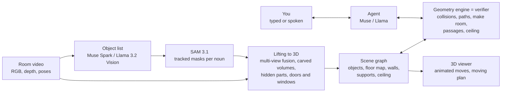

# PIVOT — verified spatial reasoning for real rooms

[](https://github.com/MarinaBeguin/PIVOT/actions/workflows/ci.yml)


**Film a room, then ask in plain words — typed or spoken — whether furniture fits, and how to
rearrange it.** PIVOT rebuilds the room in 3D, finds every object with **SAM 3.1**, and a
**Muse** (or **Llama**) agent answers by calling geometric tools that check every claim:
collisions on the real shapes, room to pass, ceiling height, a complete collision-free path.
The language model never makes up geometry: every answer is backed by a computation.

Built for the **Meta Global AI Hackathon 2026** (October 26 – November 4, 2026) — **Indie
developer track, "Push the Frontier" theme**: it gives assistants and robots a new capability,
reasoning about real space with answers they can prove. The repository was created on October 27.

| | |
|---|---|
| **Live demo** | *coming soon* |
| **Video walkthrough (3 min)** | *coming soon* |



---

## The problem: AI assistants hallucinate space

Large language models reason well about intentions ("clear the way to the window") but not
about centimeters. Asked about a real room, they state that a sofa "fits" or a chair "can go
under the desk" without being able to check: **spatial hallucination**. A wrong spatial answer
is costly — a sofa that does not pass the door, a returned order, a passage left too narrow for a
wheelchair — and it is the first thing a user notices.

Geometric planners, on the other hand, can verify a move but do not understand a request made in
words. **PIVOT combines both**: the language model interprets the request and decides what to
test; a geometry engine acts as the verifier and returns measurements (penetration depth,
clearance, path length); the model revises its proposal until a verified solution exists, or
explains with the measured numbers why it is impossible and proposes the closest feasible
alternative.

On a real office scanned with a phone, Muse alone wrongly claims a move is feasible in
**15 of 36** requests; with PIVOT's verification, **3 of 36**, with no false refusal
([results](#results)).

## Who it is for

| User | What they ask | What PIVOT adds |
|---|---|---|
| **People moving or furnishing a home**, furniture buyers (e.g. on Facebook Marketplace) | "Will this sofa fit next to the window, and can it get there through the door?" | A verified path, not just a measurement: the move is checked from the door to its spot. Fewer returns. |
| **Wheelchair users, elderly people living at home, occupational therapists** | "Can a wheelchair still reach every part of the room if I move the desk here?" | A passage check at 90 cm from the doors, and the list of moves that make a room accessible. Measured, not estimated. |
| **Wearers of Meta Ray-Ban / Oakley Meta / Orion glasses** | Looking at the room: "Where can I put this desk and keep 90 cm of passage?" | Spoken question, spoken answer, every number verified: the spatial layer Meta AI needs to answer about the physical world. |
| **Quest (mixed reality) users** | "Free a 2 × 2 m play area." | The fewest moves of chairs and tables that clear the space, each one checked. |
| **Home robotics** (e.g. Meta FAIR's Habitat and PARTNR settings) | A rearrangement plan written by a language model | The verification layer between a plan in words and its physical execution. |

The core of PIVOT is not interior design: it is **verified spatial reasoning** — an assistant that
understands a request in words and answers only with what it computed on the real geometry. That
is what an assistant that sees the world through a camera, as on Meta's glasses and headsets,
is missing today. The whole chain uses Meta models: SAM 3.1 to see, Muse or Llama to reason,
Muse Voice Transcribe or wav2vec 2.0 to listen.

## What it does

Two requests on the scanned office (wording abridged; every number comes from the geometric
tools on this scene):

> **You:** Can chair 5 go under table 72?
> **PIVOT:** Yes. I checked that it can slide under the table without hitting anything, as far in
> as it goes: 44% of the chair ends under the table top. The tightest spot on the way leaves 5 cm.
>
> **You:** Put trash can 102 next to door 26 without blocking any door.
> **PIVOT:** Done. I slid it 2.5 m to the wall right beside door 26, 5 cm from the frame and out
> of the passage; the tightest spot on the way left 6 cm. A closer free spot would have stood in
> front of door 29, so I did not use it. A wheelchair can still reach every object from the doors.

- **Verified moves** — collisions are tested on carved voxel volumes, not boxes, so a chair can
  slide under a table top; every path is searched in (x, y, rotation) and re-validated exactly.
- **Make room** — when other objects block the way, they are pushed aside, the object passes,
  then they are put back as close as possible to where they were.
- **Carry** light objects over furniture, or put them on a desk; gravity keeps every object on a
  surface; nothing may rise above the **ceiling**.
- **Accessibility** — after a rearrangement, PIVOT checks that a person (60 cm) or a wheelchair
  (90 cm) can still reach every object from the doors.
- **Moving plan** — a printable page with a plan seen from above and numbered steps ("Slide the
  chair (#5) 1.2 m to 27 cm from the table (#72), turning it 90 degrees"), flagging the moves that
  need **two people**.
- **Voice** — speak instead of typing (Muse Voice Transcribe, or wav2vec 2.0 with open weights);
  answers can be read aloud, as on glasses without a screen.
- **Undo** any move, including multi-step ones; the 3D viewer animates every executed path.

<table>
<tr>
<td width="50%"></td>
<td width="50%"></td>
</tr>
<tr>
<td>The office rebuilt from an iPhone scan: 23 objects as carved volumes, doors and windows set in the walls.</td>
<td>The printable moving plan: numbered moves, and in green the floor a wheelchair can still reach.</td>
</tr>
</table>

## Meta AI models

| Model | Role in PIVOT | API version | Open-weight version |
|---|---|---|---|
| **SAM 3.1** | Segments and tracks every object of the video from a noun ("chair", "lamp") | Meta Model API (`sam-3.1`, parsed with `meta-sam-parser`) | `facebook/sam3.1`, self-hosted (multiplex video predictor, 64 objects per prompt) |
| **Muse Spark 1.3** | Agent with 11 geometric tools; lists the kinds of objects a video shows | Meta Model API | — |
| **Llama 3.1 8B Instruct** | The same agent, with tool calling | — | Served by vLLM on our GPU |
| **Llama 3.2 11B Vision Instruct** | Lists the kinds of objects a video shows | — | transformers, on our GPU |
| **Muse Voice Transcribe 1.0** | Spoken requests, with the scene's object names as keywords | Meta Model API (`/asr/transcribe`) | — |
| **wav2vec 2.0** (`facebook/wav2vec2-large-960h-lv60-self`) | Spoken requests (English) | — | transformers, on the CPU |



## How it works



1. **Perception.** A vision model looks at frames spread over the video and names the kinds of
   objects that matter (up to 20 through the API, 8 with open weights); SAM 3.1 tracks each one
   through the video. Results are cached per video, so a scene is segmented once.
2. **From 2D to 3D.** Each mask is back-projected with depth; a point is kept only if several
   views agree (voxel voting). Tracks are merged or split with explicit rules (never merge two
   tracks SAM separated in the same frame; a part whose mask lies inside another object's mask is
   attached to it). Objects become 4 cm voxel shapes carved by the free space seen through them,
   thin legs kept from the masks; hidden parts are completed at the visible heights; doors and
   windows are snapped into the walls.
3. **The verifier.** Placement checks (collisions, walls, clearance, ceiling, warnings in front of
   doors and windows), A* motion planning in (x, y, yaw) by height slabs with exact re-validation,
   blocking objects moved aside and put back, carried moves (lift, carry, lower), passage checks.
4. **The agent.** Muse or Llama gets the request and 11 tools. Its instructions forbid any claim
   no tool result supports, and require it to quote the measurements, in plain language.

## Results

36 requests generated on the real office: "put X next to Y", the same "keeping doors and windows
clear", "put X exactly at (x, y)", "tuck X under Y", "put X on Y", and "at (x, y)" where other
objects are in the way. 19 are feasible, 17 are not (the right answer is then to refuse). A
judge replays every executed motion with exact geometry. Four variants share the same tasks:

| Variant | Success (95% CI) | False claims | False refusals | Expected cost* | Latency p50 |
|---|---|---|---|---|---|
| Muse alone (`llm_only`) | 56% (40–70%) | 15/36 | 1/36 | 4.19 | 15 s |
| Muse + final feasibility check (`llm_check`) | 89% (75–96%) | 2/36 | 2/36 | 0.61 | 27 s |
| **PIVOT: Muse + verifying tools** | **92% (78–97%)** | 3/36 | **0/36** | 0.83 | 23 s |
| Geometric search alone (`planner_only`) | 97% (86–100%) | 1/36 | 0/36 | 0.28 | 12 s |

\*A false claim (saying a move works when it does not) is counted as 10 times worse than a false
refusal. Muse alone, when wrong, puts objects through others by 14 cm on average.

The geometric search alone scores highest **only on requests it can parse by construction**: the
task labels come from the same planner. It cannot take a request in words, nor constraints that
exist only in the sentence ("without blocking the door"). PIVOT keeps the planner's reliability
while understanding language. Reproduce with `python -m pivot.eval` (see below).

## Two versions: with or without an API key

| | **API version** (`run_api.sh`) | **Open-weight version** (`run_open.sh`) |
|---|---|---|
| Needs | A Meta Model API key | An NVIDIA GPU (SAM 3.1 peaked at 45 GB on an A6000), no key |
| Object list | Muse Spark (up to 20 kinds) | Llama 3.2 Vision (up to 8 kinds) |
| Segmentation | SAM 3.1 through the API, 5 prompts in parallel | SAM 3.1 self-hosted, 3 GPU jobs in parallel |
| Agent | Muse Spark | Llama 3.1 8B (vLLM) |
| Voice | Muse Voice Transcribe | wav2vec 2.0 (English) |

The open-weight script picks the best objects available: SAM 3.1 API results already computed
for the video are reused without a key; else, with a key, the API segments; else everything runs
on your GPUs.

### Input

A capture with color frames, depth and camera poses — today a **ScanNet++ iPhone capture**
(RGB, LiDAR depth, ARKit poses) and its video (one frame out of 10). Rebuilding a room from a
plain phone video without depth is on the [roadmap](#limitations-and-roadmap).

### API version

```bash
git clone https://github.com/MarinaBeguin/PIVOT.git && cd PIVOT
pip install -e ".[serve]"
cp .env.example .env            # then set META_API_KEY in .env (never committed)

bash scripts/run_api.sh <scannetpp_scene_dir> <video.mp4> <out_dir>
# open http://127.0.0.1:8765 (from another machine: ssh -L 8765:127.0.0.1:8765 <host>)
```

The script lists the objects, tracks them with a progress bar and a time estimate, builds the 3D
scene, then serves the viewer with the agent. Every step already done is skipped on the next run.

### Open-weight version (no key)

```bash
bash scripts/cluster/setup_sam3_env.sh     # once: SAM 3.1 environment and weights
bash scripts/cluster/setup_llama_env.sh    # once: vLLM, Llama 3.1 8B and Llama 3.2 Vision
bash scripts/run_open.sh <scannetpp_scene_dir> <video.mp4> <out_dir>
```

The Meta Llama and SAM 3.1 weights are gated on Hugging Face: request access to
`facebook/sam3.1`, `meta-llama/Llama-3.1-8B-Instruct` and `meta-llama/Llama-3.2-11B-Vision-Instruct`
first.

### Options of both scripts

```bash
bash scripts/run_api.sh --quality fast <scene> <video> <out>   # fast (1/3 of the frames), medium (1/2), full
bash scripts/run_api.sh <scene> <video> <out> sofa bed "coffee table"   # your own object list
```

| Variable | Default | Meaning |
|---|---|---|
| `PIVOT_SAM_WORKERS` | 5 (API), 3 (GPU) | Prompts tracked at the same time |
| `PIVOT_MAX_OBJECTS_API` / `PIVOT_MAX_OBJECTS_OPEN` | 20 / 8 | Most kinds of objects listed |
| `PORT` | 8765 | Port of the viewer |

### Docker (serve a built scene)

```bash
docker build -t pivot .
docker run -p 8000:8000 -e META_API_KEY=... -v /path/to/out_dir/scene:/scene:ro pivot
```

### Command line

```bash
python -m pivot.server --scene-dir <out_dir>/scene --chat          # viewer + agent
python -m pivot.agent --scene <out_dir>/scene/scene.json "Can chair 5 go under table 72?"
python -m pivot.eval generate --scene <scene.json> --tasks tasks.json
python -m pivot.eval run --scene <scene.json> --tasks tasks.json --out results.jsonl
python -m pivot.eval summary --help
```

## Engineering

- **201 tests** (geometry, lifting on synthetic rooms rendered exactly, planning, agent with a
  scripted model, server, evaluation), **mypy strict**,
  **pylint 10/10**, Google-style docstrings — run by `scripts/check.sh`.
- **CI** on every pull request: install in a fresh environment, tests, mypy, pylint, and the
  Docker image is built. `main` is protected: changes land only through pull requests with green
  checks.
- **Docker** image for the web app: non-root user, healthcheck, port from the host.
- No secrets in the repository: the API key lives in `.env` (git-ignored) or in the environment.

```text
src/pivot/
├── geometry/     boxes, voxel shapes, collisions, floor map
├── data/         ScanNet++ loader, video encoding
├── perception/   object inventory, SAM 3.1 (self-hosted), detections and tracks
├── meta/         Meta Model API client, SAM 3.1 through the API
├── lifting/      masks to 3D: fusion, carved volumes, hidden parts, doors and windows
├── scene/        scene graph, supports, example scenes
├── planning/     placement, motion planning, make room, carry, passages, moving plan
├── agent/        tool-calling agent (Muse or Llama) and its 11 tools
├── server/       FastAPI server: viewer, chat, speech
├── viz/          3D viewer (three.js), printable plan
└── eval/         task suite, variants, judge, metrics
```

## Limitations and roadmap

Known limitations, measured rather than hidden:

- Objects slide and rotate about the vertical axis; they are never tilted. The person carrying an
  object is not modeled, and masses are unknown (the two-person flag comes from size and kind).
- SAM 3.1 tracks the kinds of objects it is given: an object never named is not detected.
- 4 cm voxels: thin tubes can be missed; space never seen (behind a monitor) stays occupied.
  Hidden parts are inferred, not observed.
- `NO_PATH` means no path exists at the planning resolution (5 cm, 22.5°), not a proof of
  impossibility; making room can take up to about a minute and a half in hard cases.

Next:

- **Any phone video**, without depth sensor: poses and depth from Meta's VGGT or MapAnything.
- **Moving between rooms**: one scan covering several rooms; the planner already passes through
  doors.
- **"Will the sofa from this photo fit?"**: insert an object from a picture and its size, then let
  PIVOT find a spot and the rearrangement it needs.
- **Real-looking objects** with SAM 3D Objects, shown in place of the point cloud.

## License

MIT — see [LICENSE](LICENSE).
